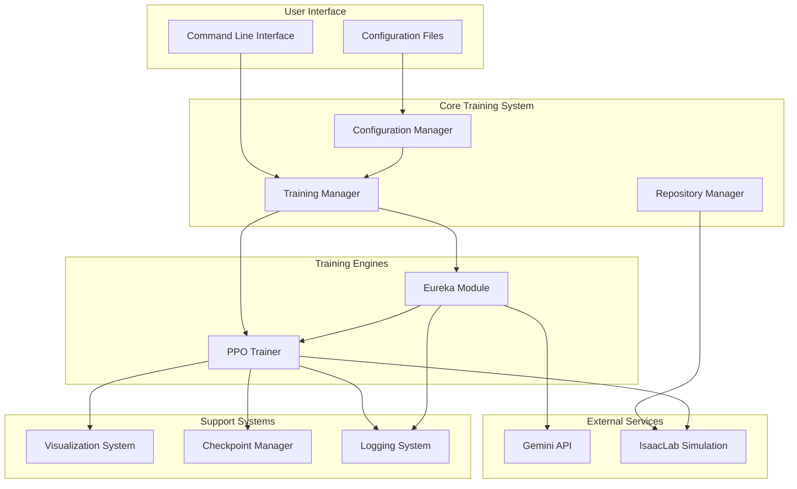

# Design Document: LEAP Hand Eureka Training System

## Overview

The LEAP Hand Eureka Training System is an integrated robotic training platform that combines the IsaacLabEurekai simulation framework with Gemini LLM-based reward generation. The system enables training of two robot configurations (LEAP hand alone and 2DOF arm with LEAP hand) to perform Rubik's cube rotation tasks using either traditional PPO (Proximal Policy Optimization) or Eureka-enhanced reward learning.

### Key Components

- **Repository Manager**: Handles cloning and setup of IsaacLabEurekai repository
- **Configuration Manager**: Manages environment variables and training configurations
- **Gemini Integration Layer**: Interfaces with Gemini API for reward function generation
- **PPO Training Engine**: Executes reinforcement learning using PPO algorithm
- **Eureka Reward Generator**: Automates reward function creation and evaluation
- **Visualization System**: Renders training progress to laptop display
- **Checkpoint Manager**: Handles saving and loading of training state
- **Logging System**: Records training metrics and performance data

### Design Goals

1. **Modularity**: Separate concerns between setup, training, reward generation, and visualization
2. **Robustness**: Graceful error handling with retry mechanisms and fallback behaviors
3. **Flexibility**: Support multiple robot configurations and training modes through configuration
4. **Observability**: Comprehensive logging and visualization for monitoring training progress
5. **Reproducibility**: Checkpoint system enables resuming interrupted training runs

## Architecture

### System Architecture Diagram



### Component Interaction Flow

**Training Initialization:**
1. CLI parses command-line arguments and configuration file path
2. Configuration Manager loads and validates configuration
3. Repository Manager verifies IsaacLabEurekai installation
4. Training Manager initializes appropriate training mode (PPO or Eureka)

**PPO Training Loop:**
1. PPO Trainer initializes robot and environment in IsaacLab
2. Collects observations and applies actions for N episodes
3. Computes policy updates using PPO algorithm
4. Saves checkpoints at configured intervals
5. Logs metrics and updates visualization

**Eureka Training Loop:**
1. Eureka Module generates reward function code via Gemini API
2. Reward function is validated and compiled
3. PPO Trainer evaluates reward function over 100 episodes
4. Performance is compared against current best
5. Process iterates for configured number of iterations
6. Best reward function and policy are saved

## Components and Interfaces

### 1. Repository Manager

**Responsibilities:**
- Clone IsaacLabEurekai repository from GitHub
- Install dependencies specified in repository
- Verify installation integrity

**Interface:**
```python
class RepositoryManager:
    def setup_repository(self, target_dir: str) -> SetupResult:
        """
        Clone and setup IsaacLabEurekai repository.
        
        Args:
            target_dir: Directory to clone repository into
            
        Returns:
            SetupResult with status and error message if failed
            
        Raises:
            RepositorySetupError: If clone or setup fails
        """
        pass
    
    def verify_installation(self) -> bool:
        """
        Verify that IsaacLab and Eureka components are properly installed.
        
        Returns:
            True if installation is valid, False otherwise
        """
        pass
```

**Error Handling:**
- Directory conflicts: Check existence before cloning
- Network failures: Report with clear error message
- Dependency failures: Indicate which dependency failed
- Verification failures: Specify which component is missing

### 2. Configuration Manager

**Responsibilities:**
- Load and parse configuration files (.env and training config)
- Validate required fields and format
- Provide configuration access to other components
- Support command-line overrides

**Interface:**
```python
class ConfigurationManager:
    def load_env_config(self, env_path: str = ".env") -> EnvConfig:
        """
        Load environment configuration from .env file.
        
        Args:
            env_path: Path to .env file
            
        Returns:
            EnvConfig object with API credentials
            
        Raises:
            ConfigurationError: If file is missing or invalid
        """
        pass
    
    def load_training_config(self, config_path: str) -> TrainingConfig:
        """
        Load training configuration from file.
        
        Args:
            config_path: Path to configuration file (YAML or JSON)
            
        Returns:
            TrainingConfig object with all training parameters
            
        Raises:
            ConfigurationError: If required parameters are missing
        """
        pass
    
    def create_default_env_file(self, env_path: str = ".env") -> None:
        """
        Create a default .env file with placeholder values.
        
        Args:
            env_path: Path where .env file should be created
        """
        pass
    
    def validate_config(self, config: TrainingConfig) -> List[str]:
        """
        Validate training configuration.
        
        Args:
            config: Configuration to validate
            
        Returns:
            List of validation error messages (empty if valid)
        """
        pass
```

**Configuration Schema:**

*Environment Configuration (.env):*
```
GEMINI_API_KEY=<api_key>
LLM_MODEL=gemini-1.5-pro
```

*Training Configuration (YAML):*
```yaml
robot_type: "leap_hand" | "arm_system"
training_mode: "ppo" | "eureka"
ppo:
  batch_size: 2048
  num_epochs: 10
  learning_rate: 0.0003
  gamma: 0.99
  clip_epsilon: 0.2
eureka:
  num_iterations: 10
  evaluation_episodes: 100
  improvement_threshold: 0.05
  generation_timeout: 60
task:
  max_episode_steps: 1000
  rotation_tolerance: 5.0  # degrees
  cube_distance_min: 0.3
  cube_distance_max: 0.5
  drop_threshold: 0.5  # meters
visualization:
  enabled: true
  fps: 30
  update_frequency: 1  # Hz
checkpoint:
  enabled: true
  interval: 1000  # iterations
  save_timeout: 10  # seconds
logging:
  output_dir: "./logs"
  csv_export: true
  precision: "millisecond"
```

### 3. Gemini Integration Layer

**Responsibilities:**
- Interface with Gemini API for reward function generation
- Handle authentication and request formatting
- Implement retry logic with exponential backoff
- Parse API responses into executable code

**Interface:**
```python
class GeminiClient:
    def __init__(self, api_key: str, model: str, timeout: int = 30):
        """
        Initialize Gemini API client.
        
        Args:
            api_key: Gemini API authentication key
            model: Model identifier (e.g., "gemini-1.5-pro")
            timeout: Request timeout in seconds
        """
        pass
    
    def generate_reward_function(
        self, 
        prompt: str, 
        context: Dict[str, Any]
    ) -> str:
        """
        Generate reward function code using Gemini API.
        
        Args:
            prompt: Prompt describing reward function requirements
            context: Context information (robot state variables, task description)
            
        Returns:
            Generated Python code as string
            
        Raises:
            GeminiAPIError: If API call fails after all retries
            GeminiTimeoutError: If request exceeds timeout
        """
        pass
    
    def _retry_with_backoff(
        self, 
        func: Callable, 
        max_retries: int = 3
    ) -> Any:
        """
        Execute function with exponential backoff retry logic.
        
        Args:
            func: Function to execute
            max_retries: Maximum number of retry attempts
            
        Returns:
            Function result if successful
            
        Raises:
            Exception: If all retries are exhausted
        """
        pass
```

**Retry Strategy:**
- Initial backoff: 1 second
- Backoff multiplier: 2x
- Maximum backoff: 8 seconds
- Maximum retries: 3

**Error Conditions:**
- Network errors: Retry with backoff
- Timeout errors: Log and mark as failed
- Invalid response format: Log parsing failure
- Rate limiting: Honor retry-after headers

### 4. PPO Training Engine

**Responsibilities:**
- Initialize robot and environment in IsaacLab simulation
- Collect observations and apply actions
- Compute policy updates using PPO algorithm
- Interface with checkpoint and logging systems

**Interface:**
```python
class PPOTrainer:
    def __init__(self, config: TrainingConfig, robot_type: str):
        """
        Initialize PPO trainer.
        
        Args:
            config: Training configuration
            robot_type: "leap_hand" or "arm_system"
        """
        pass
    
    def initialize_environment(self) -> None:
        """
        Initialize robot model and Rubik's cube in simulation.
        
        Raises:
            InitializationError: If robot or environment setup fails
        """
        pass
    
    def train_iteration(self, reward_fn: Optional[Callable] = None) -> TrainingMetrics:
        """
        Execute one training iteration.
        
        Args:
            reward_fn: Optional custom reward function (for Eureka mode)
            
        Returns:
            TrainingMetrics with episode rewards, success rate, losses
        """
        pass
    
    def evaluate_policy(
        self, 
        num_episodes: int, 
        reward_fn: Optional[Callable] = None
    ) -> float:
        """
        Evaluate current policy over multiple episodes.
        
        Args:
            num_episodes: Number of evaluation episodes
            reward_fn: Optional custom reward function
            
        Returns:
            Mean cumulative reward over episodes
        """
        pass
    
    def save_policy(self, path: str) -> bool:
        """
        Save current policy weights to disk.
        
        Args:
            path: File path for saving policy
            
        Returns:
            True if save successful, False otherwise
        """
        pass
    
    def load_policy(self, path: str) -> None:
        """
        Load policy weights from disk.
        
        Args:
            path: File path to policy checkpoint
            
        Raises:
            CheckpointError: If checkpoint is invalid or corrupted
        """
        pass
```

**Observation Space:**

*LEAP Hand Only:*
- Joint positions: 16-dimensional vector (LEAP hand has 16 DOF)
- Joint velocities: 16-dimensional vector
- Fingertip contact forces: 5-dimensional vector (one per finger)
- Cube orientation: 4-dimensional quaternion
- Cube position: 3-dimensional coordinates

*Arm System (2DOF + LEAP Hand):*
- Arm joint positions: 2-dimensional vector
- Arm joint velocities: 2-dimensional vector
- LEAP hand joint positions: 16-dimensional vector
- LEAP hand joint velocities: 16-dimensional vector
- Fingertip contact forces: 5-dimensional vector
- Cube orientation: 4-dimensional quaternion
- Cube position: 3-dimensional coordinates

**Action Space:**
- LEAP Hand Only: 16-dimensional continuous action (joint torques)
- Arm System: 18-dimensional continuous action (2 arm + 16 hand joint torques)

**PPO Hyperparameters:**
- Batch size: 64-4096 (configurable)
- Num epochs: 3-15 (configurable)
- Learning rate: 0.0003 (default)
- Gamma (discount): 0.99
- GAE lambda: 0.95
- Clip epsilon: 0.2

### 5. Eureka Reward Generator

**Responsibilities:**
- Generate reward function candidates using Gemini API
- Validate and compile generated code
- Evaluate reward functions through training episodes
- Select and update best performing reward function

**Interface:**
```python
class EurekaModule:
    def __init__(
        self, 
        gemini_client: GeminiClient, 
        ppo_trainer: PPOTrainer,
        config: EurekaConfig
    ):
        """
        Initialize Eureka reward generation module.
        
        Args:
            gemini_client: Gemini API client
            ppo_trainer: PPO trainer for evaluation
            config: Eureka configuration parameters
        """
        pass
    
    def generate_reward_function(self, iteration: int) -> Optional[Callable]:
        """
        Generate a new reward function using Gemini API.
        
        Args:
            iteration: Current Eureka iteration number
            
        Returns:
            Compiled reward function if valid, None if generation failed
        """
        pass
    
    def validate_reward_function(self, code: str) -> Tuple[bool, Optional[Callable]]:
        """
        Validate and compile reward function code.
        
        Args:
            code: Python code string for reward function
            
        Returns:
            (is_valid, compiled_function) tuple
        """
        pass
    
    def evaluate_reward_function(
        self, 
        reward_fn: Callable, 
        num_episodes: int = 100
    ) -> RewardEvaluationResult:
        """
        Evaluate a reward function by training with it.
        
        Args:
            reward_fn: Reward function to evaluate
            num_episodes: Number of episodes for evaluation
            
        Returns:
            RewardEvaluationResult with performance metrics
        """
        pass
    
    def run_eureka_training(self) -> EurekaTrainingResult:
        """
        Execute full Eureka training loop.
        
        Returns:
            EurekaTrainingResult with best reward function and policy
        """
        pass
```

**Reward Function Generation Process:**

1. **Context Building**: Assemble prompt with:
   - Task description (Rubik's cube rotation)
   - Available state variables (robot observations)
   - Success criteria (90° rotation within tolerance)
   - Performance feedback from previous iterations

2. **Code Generation**: Send prompt to Gemini API with timeout

3. **Validation**: 
   - Parse response to extract Python code
   - Check for required function signature
   - Compile code and catch syntax errors
   - Verify function accepts correct arguments

4. **Evaluation**:
   - Run PPO training for 100 episodes with new reward function
   - Catch runtime exceptions during evaluation
   - Compute mean cumulative reward

5. **Selection**:
   - Compare performance to current best (threshold: 5% improvement)
   - Update active reward function if better
   - Store reward function code and metadata

**Reward Function Signature:**
```python
def reward_function(
    observations: np.ndarray,
    actions: np.ndarray,
    next_observations: np.ndarray,
    cube_rotation: float,
    cube_dropped: bool,
    timestep: int
) -> float:
    """
    Compute reward for transition.
    
    Args:
        observations: Current state observations
        actions: Actions taken
        next_observations: Next state observations
        cube_rotation: Current rotation progress toward 90 degrees
        cube_dropped: Whether cube was dropped
        timestep: Current episode timestep
        
    Returns:
        Scalar reward value
    """
    pass
```

### 6. Visualization System

**Responsibilities:**
- Render simulation environment to laptop display
- Update display at target framerate
- Show training metrics overlay
- Support enable/disable toggle

**Interface:**
```python
class VisualizationSystem:
    def __init__(self, config: VisualizationConfig):
        """
        Initialize visualization system.
        
        Args:
            config: Visualization configuration
        """
        pass
    
    def initialize_renderer(self) -> bool:
        """
        Initialize display renderer.
        
        Returns:
            True if initialization successful, False otherwise
        """
        pass
    
    def render_frame(self, scene_data: SceneData) -> None:
        """
        Render one frame of simulation.
        
        Args:
            scene_data: Current scene state (robot, cube, environment)
        """
        pass
    
    def update_metrics(self, metrics: TrainingMetrics) -> None:
        """
        Update metrics overlay display.
        
        Args:
            metrics: Current training metrics
        """
        pass
    
    def toggle_rendering(self, enabled: bool) -> None:
        """
        Enable or disable rendering.
        
        Args:
            enabled: Whether rendering should be enabled
        """
        pass
```

**Display Elements:**
- 3D scene: Robot model, Rubik's cube, environment
- Metrics overlay:
  - Episode reward (numeric)
  - Success rate (percentage)
  - Current iteration
  - Training time elapsed

**Performance Requirements:**
- Minimum 30 FPS rendering when enabled
- Metrics update at 1 Hz minimum
- Toggle response within 100ms
- Graceful fallback if display unavailable

### 7. Checkpoint Manager

**Responsibilities:**
- Save training state at configured intervals
- Load checkpoints for resuming training
- Verify checkpoint integrity
- Manage checkpoint file lifecycle

**Interface:**
```python
class CheckpointManager:
    def __init__(self, config: CheckpointConfig):
        """
        Initialize checkpoint manager.
        
        Args:
            config: Checkpoint configuration
        """
        pass
    
    def save_checkpoint(
        self, 
        iteration: int, 
        policy_state: Dict[str, Any],
        optimizer_state: Dict[str, Any],
        training_stats: Dict[str, Any]
    ) -> bool:
        """
        Save training checkpoint.
        
        Args:
            iteration: Current training iteration
            policy_state: Policy network state dict
            optimizer_state: Optimizer state dict
            training_stats: Training statistics
            
        Returns:
            True if save successful, False otherwise
        """
        pass
    
    def load_checkpoint(self, checkpoint_path: str) -> CheckpointData:
        """
        Load checkpoint from disk.
        
        Args:
            checkpoint_path: Path to checkpoint file
            
        Returns:
            CheckpointData with all saved state
            
        Raises:
            CheckpointError: If checkpoint is corrupted or invalid
        """
        pass
    
    def verify_checkpoint(self, checkpoint_path: str) -> bool:
        """
        Verify checkpoint file integrity.
        
        Args:
            checkpoint_path: Path to checkpoint file
            
        Returns:
            True if checkpoint is valid, False otherwise
        """
        pass
```

**Checkpoint Format:**
```python
{
    "version": "1.0",
    "timestamp": "2024-01-15T10:30:00.000Z",
    "iteration": 5000,
    "robot_type": "leap_hand",
    "training_mode": "eureka",
    "policy_state": {...},  # PyTorch state dict
    "optimizer_state": {...},  # Optimizer state dict
    "training_stats": {
        "total_episodes": 50000,
        "mean_reward": 150.5,
        "success_rate": 0.67,
        "training_time_seconds": 7200
    },
    "reward_function_code": "..."  # For Eureka mode
}
```

**Save Strategy:**
- Save every N iterations (configurable)
- Keep last 5 checkpoints
- Retry once if save fails
- Timeout: 10 seconds per save operation

### 8. Logging System

**Responsibilities:**
- Record training metrics to structured logs
- Export logs in multiple formats (CSV, JSON)
- Generate training summary reports
- Provide high-precision timestamps

**Interface:**
```python
class LoggingSystem:
    def __init__(self, config: LoggingConfig):
        """
        Initialize logging system.
        
        Args:
            config: Logging configuration
        """
        pass
    
    def log_training_iteration(self, iteration: int, metrics: TrainingMetrics) -> None:
        """
        Log metrics from one training iteration.
        
        Args:
            iteration: Training iteration number
            metrics: Metrics to log
        """
        pass
    
    def log_eureka_generation(
        self, 
        iteration: int, 
        reward_code: str,
        performance: float,
        is_best: bool
    ) -> None:
        """
        Log Eureka reward function generation.
        
        Args:
            iteration: Eureka iteration number
            reward_code: Generated reward function code
            performance: Mean cumulative reward
            is_best: Whether this is the new best reward function
        """
        pass
    
    def export_csv(self, output_path: str) -> None:
        """
        Export logs to CSV format.
        
        Args:
            output_path: Path for CSV file
        """
        pass
    
    def generate_summary(self) -> TrainingSummary:
        """
        Generate training summary report.
        
        Returns:
            TrainingSummary with final metrics and duration
        """
        pass
```

**Log Entry Format:**
```json
{
    "timestamp": "2024-01-15T10:30:00.123Z",
    "iteration": 1000,
    "episode_reward_mean": 145.6,
    "episode_reward_std": 23.4,
    "success_rate": 0.65,
    "policy_loss": 0.023,
    "value_loss": 0.045,
    "learning_rate": 0.0003,
    "mode": "eureka",
    "reward_function_id": "eureka_iter_5"
}
```

### 9. Training Manager

**Responsibilities:**
- Orchestrate overall training workflow
- Initialize all components
- Handle training loop execution
- Coordinate between PPO and Eureka modes

**Interface:**
```python
class TrainingManager:
    def __init__(self, config: TrainingConfig):
        """
        Initialize training manager.
        
        Args:
            config: Complete training configuration
        """
        pass
    
    def setup(self) -> None:
        """
        Setup all training components.
        
        Raises:
            SetupError: If any component fails to initialize
        """
        pass
    
    def run_ppo_training(self) -> None:
        """
        Execute standard PPO training loop.
        """
        pass
    
    def run_eureka_training(self) -> None:
        """
        Execute Eureka-enhanced training loop.
        """
        pass
    
    def resume_from_checkpoint(self, checkpoint_path: str) -> None:
        """
        Resume training from saved checkpoint.
        
        Args:
            checkpoint_path: Path to checkpoint file
        """
        pass
```

## Data Models

### Configuration Data Classes

```python
@dataclass
class EnvConfig:
    """Environment configuration from .env file."""
    gemini_api_key: str
    llm_model: str = "gemini-1.5-pro"

@dataclass
class PPOConfig:
    """PPO hyperparameters."""
    batch_size: int = 2048
    num_epochs: int = 10
    learning_rate: float = 0.0003
    gamma: float = 0.99
    gae_lambda: float = 0.95
    clip_epsilon: float = 0.2

@dataclass
class EurekaConfig:
    """Eureka configuration."""
    num_iterations: int = 10
    evaluation_episodes: int = 100
    improvement_threshold: float = 0.05
    generation_timeout: int = 60

@dataclass
class TaskConfig:
    """Task configuration."""
    max_episode_steps: int = 1000
    rotation_tolerance: float = 5.0  # degrees
    cube_distance_min: float = 0.3  # meters
    cube_distance_max: float = 0.5  # meters
    drop_threshold: float = 0.5  # meters

@dataclass
class VisualizationConfig:
    """Visualization configuration."""
    enabled: bool = True
    fps: int = 30
    update_frequency: int = 1  # Hz

@dataclass
class CheckpointConfig:
    """Checkpoint configuration."""
    enabled: bool = True
    interval: int = 1000  # iterations
    save_timeout: int = 10  # seconds
    max_checkpoints: int = 5

@dataclass
class LoggingConfig:
    """Logging configuration."""
    output_dir: str = "./logs"
    csv_export: bool = True
    precision: str = "millisecond"

@dataclass
class TrainingConfig:
    """Complete training configuration."""
    robot_type: str  # "leap_hand" or "arm_system"
    training_mode: str  # "ppo" or "eureka"
    ppo: PPOConfig
    eureka: EurekaConfig
    task: TaskConfig
    visualization: VisualizationConfig
    checkpoint: CheckpointConfig
    logging: LoggingConfig
```

### Training Data Classes

```python
@dataclass
class TrainingMetrics:
    """Metrics from one training iteration."""
    iteration: int
    episode_reward_mean: float
    episode_reward_std: float
    success_rate: float
    policy_loss: float
    value_loss: float
    learning_rate: float
    timestamp: str

@dataclass
class RewardEvaluationResult:
    """Results from evaluating a reward function."""
    mean_cumulative_reward: float
    std_cumulative_reward: float
    success_rate: float
    num_crashes: int
    is_valid: bool

@dataclass
class EurekaTrainingResult:
    """Results from complete Eureka training."""
    best_reward_code: str
    best_reward_performance: float
    best_policy_path: str
    total_iterations: int
    successful_generations: int
    training_duration_seconds: float

@dataclass
class CheckpointData:
    """Data loaded from checkpoint."""
    version: str
    iteration: int
    robot_type: str
    training_mode: str
    policy_state: Dict[str, Any]
    optimizer_state: Dict[str, Any]
    training_stats: Dict[str, Any]
    reward_function_code: Optional[str]

@dataclass
class TrainingSummary:
    """Final training summary."""
    robot_type: str
    training_mode: str
    total_iterations: int
    final_mean_reward: float
    final_success_rate: float
    training_duration_seconds: float
    checkpoints_saved: int
    best_reward_code: Optional[str]
```

## Correctness Properties

**Note:** This system does not use property-based testing. This section explains why PBT is not appropriate for this infrastructure and configuration-heavy system.

### Why Property-Based Testing Is Not Appropriate

This LEAP Hand Eureka Training System is not suitable for property-based testing because:

1. **Infrastructure as Code**: The system primarily involves infrastructure setup, repository cloning, dependency installation, and environment configuration. These are one-time setup operations with side effects, not pure functions with varying inputs that would benefit from randomized property testing.

2. **External Service Integration**: The Gemini API integration tests our interaction with an external service. The API behavior is deterministic from our perspective and already tested by Google. We test our integration logic with mocked responses rather than testing the API itself across many random inputs.

3. **Configuration Management**: Configuration validation works best with specific valid/invalid examples that cover edge cases (missing keys, invalid types, boundary values) rather than randomly generated configurations. Example-based tests provide clearer documentation and more targeted coverage.

4. **Training Orchestration**: The training workflows are complex orchestrations involving multiple external systems (IsaacLab simulation, file system I/O, API calls). These are inherently side-effect-heavy operations. Testing with 100 random training configurations doesn't provide meaningful value over carefully designed example-based scenarios.

5. **Side-Effect Heavy Operations**: Most system operations involve side effects:
   - File I/O (checkpoint save/load, log writing)
   - Network calls (Gemini API requests)
   - Simulation state management (IsaacLab environment)
   - GPU operations (neural network training)
   
   These operations are not pure functions suitable for property-based testing.

6. **Limited Pure Function Logic**: The small amount of pure function logic in the system (e.g., configuration parsing, metric calculations) is better validated with example-based unit tests that clearly document expected behavior.

### Appropriate Testing Strategy for This System

Instead of property-based testing, this system benefits from:

- **Integration Tests**: Verify that components work correctly together (e.g., Gemini API client + reward function validator, PPO trainer + checkpoint manager)

- **Example-Based Unit Tests**: Test specific scenarios for configuration validation, error handling, and data transformations with concrete examples

- **End-to-End Workflow Tests**: Validate complete training workflows (PPO mode, Eureka mode, checkpoint resumption) with real or mocked dependencies

- **Mock-Based Tests**: Isolate external dependencies (Gemini API, IsaacLab simulation, file system) to test integration logic independently

- **Smoke Tests**: Verify one-time setup operations (repository cloning, environment initialization, configuration file creation)

See the "Testing Strategy" section below for detailed test coverage goals and examples.

## Error Handling

### Error Categories

**1. Setup Errors**
- Repository clone failures
- Dependency installation failures
- Configuration file errors
- Missing or invalid API keys

**Strategy:**
- Fail fast with descriptive error messages
- Guide user to resolution (e.g., "Install git" or "Add GEMINI_API_KEY to .env")
- No automatic retries for setup errors

**2. API Errors**
- Network failures
- Timeout errors
- Rate limiting
- Invalid responses

**Strategy:**
- Retry with exponential backoff (up to 3 attempts)
- Log all API errors with request/response details
- For Eureka: mark generation as failed and continue
- For PPO: API errors should not occur (no external deps)

**3. Training Errors**
- Environment initialization failures
- Simulation crashes
- Invalid reward function execution
- Policy divergence

**Strategy:**
- Environment init: Fail fast with error message
- Simulation crashes: Log error, terminate episode, continue training
- Invalid reward function: Mark as invalid, log error, discard
- Policy divergence: Detection via loss monitoring, no auto-handling

**4. I/O Errors**
- Checkpoint save/load failures
- Log file write failures
- Configuration file read failures

**Strategy:**
- Checkpoint save: Retry once, log error if both fail, continue training
- Checkpoint load: Fail fast with integrity check results
- Log write: Continue training, report to console
- Config read: Fail fast with parse error details

### Error Logging

All errors should be logged with:
- Timestamp (millisecond precision)
- Error category
- Error message
- Stack trace (for exceptions)
- Context (e.g., current iteration, robot type)

### Graceful Degradation

**Visualization Failure:**
- Continue training without rendering
- Log warning message
- Metrics still logged to file

**Logging Failure:**
- Continue training
- Report logging failure to console
- Attempt to recover on next log attempt

**Checkpoint Save Failure:**
- Continue training
- Retry on next interval
- Warn user that progress may be lost

## Testing Strategy

This system involves primarily infrastructure setup, configuration management, external service integration, and training orchestration. The appropriate testing strategy focuses on integration tests, unit tests for configuration validation, and end-to-end workflow tests rather than property-based testing.

### Testing Approach

**1. Unit Tests**
- Configuration validation and parsing
- Error handling in individual components
- Utility functions (e.g., exponential backoff)
- Data model validation

**2. Integration Tests**
- Gemini API interaction (using test API keys or mocks)
- IsaacLab environment initialization
- Checkpoint save/load roundtrip
- Log file generation and parsing

**3. End-to-End Tests**
- Complete PPO training workflow (short run)
- Complete Eureka workflow (1-2 iterations)
- Training resumption from checkpoint
- Configuration override via CLI

**4. Mock-Based Tests**
- Mock Gemini API for reward generation testing
- Mock IsaacLab simulation for testing training logic
- Mock file system for checkpoint/log testing

### Test Coverage Goals

- Configuration Manager: 90%+ line coverage
- Gemini Integration: 80%+ with mocked API
- PPO Trainer: 70%+ (integration tests with real/mocked sim)
- Eureka Module: 75%+ (mocked API and trainer)
- Checkpoint Manager: 85%+ (file I/O mocking)
- Logging System: 85%+

### Test Execution

- Unit tests: Run on every commit (fast, < 1 minute)
- Integration tests: Run on PR (moderate, 5-10 minutes)
- End-to-end tests: Run nightly (slow, 30+ minutes with actual training)

### Why Property-Based Testing Is Not Appropriate

This system is **not suitable for property-based testing** because:

1. **Infrastructure as Code**: Repository setup, dependency installation, and environment configuration are one-time setup operations, not functions with varying inputs that benefit from randomized testing.

2. **External Service Integration**: The Gemini API integration tests external service behavior, which is deterministic from our perspective and already tested by the service provider. We test our integration logic with mocked responses, not the API itself.

3. **Configuration Validation**: Validating configuration files is better tested with specific valid/invalid examples rather than randomly generated configs.

4. **Training Workflows**: The training orchestration logic depends heavily on external systems (IsaacLab, file system, API) and has limited pure functional components. Testing with 100 random training configurations doesn't provide value over well-chosen example-based tests.

5. **Side-Effect Operations**: Most operations (file I/O, API calls, simulation) are side-effect-heavy and not pure functions suitable for property testing.

The system benefits most from:
- **Integration tests** to verify components work together correctly
- **Example-based unit tests** for configuration validation and error handling
- **End-to-end tests** to verify complete workflows
- **Mock-based tests** to isolate external dependencies

### Test Examples

**Configuration Validation Tests:**
```python
def test_valid_env_config():
    """Test loading valid .env configuration."""
    config = ConfigurationManager()
    env_config = config.load_env_config("test_fixtures/valid.env")
    assert env_config.gemini_api_key == "test_key_123"
    assert env_config.llm_model == "gemini-1.5-pro"

def test_missing_api_key():
    """Test error when GEMINI_API_KEY is missing."""
    config = ConfigurationManager()
    with pytest.raises(ConfigurationError, match="GEMINI_API_KEY"):
        config.load_env_config("test_fixtures/missing_key.env")

def test_invalid_robot_type():
    """Test validation fails for invalid robot type."""
    config = ConfigurationManager()
    training_config = TrainingConfig(robot_type="invalid", ...)
    errors = config.validate_config(training_config)
    assert "robot_type must be 'leap_hand' or 'arm_system'" in errors
```

**Gemini API Integration Tests (Mocked):**
```python
@mock.patch('requests.post')
def test_gemini_successful_generation(mock_post):
    """Test successful reward function generation."""
    mock_post.return_value.json.return_value = {
        "candidates": [{"content": {"parts": [{"text": "def reward_function(...): return 1.0"}]}}]
    }
    
    client = GeminiClient(api_key="test", model="gemini-1.5-pro")
    code = client.generate_reward_function("Generate reward", {})
    assert "def reward_function" in code

@mock.patch('requests.post')
def test_gemini_retry_on_network_error(mock_post):
    """Test retry logic on network failure."""
    mock_post.side_effect = [requests.RequestException(), mock.Mock(json=lambda: {...})]
    
    client = GeminiClient(api_key="test", model="gemini-1.5-pro")
    code = client.generate_reward_function("Generate reward", {})
    assert mock_post.call_count == 2  # Initial + 1 retry
```

**Training Workflow Tests:**
```python
def test_ppo_training_single_iteration():
    """Test single PPO training iteration completes."""
    config = create_test_config(robot_type="leap_hand", training_mode="ppo")
    trainer = PPOTrainer(config, "leap_hand")
    trainer.initialize_environment()
    
    metrics = trainer.train_iteration()
    assert metrics.iteration == 1
    assert metrics.episode_reward_mean is not None
    assert 0 <= metrics.success_rate <= 1

def test_checkpoint_save_load_roundtrip():
    """Test checkpoint can be saved and loaded."""
    manager = CheckpointManager(CheckpointConfig())
    
    original_data = {
        "policy_state": {"layer1.weight": torch.randn(10, 10)},
        "optimizer_state": {"step": 1000},
        "training_stats": {"mean_reward": 150.0}
    }
    
    success = manager.save_checkpoint(1000, **original_data)
    assert success
    
    loaded = manager.load_checkpoint("checkpoints/iter_1000.pt")
    assert loaded.iteration == 1000
    assert loaded.training_stats["mean_reward"] == 150.0
```

### Performance Testing

- Training throughput: Measure episodes/second
- Checkpoint save time: Verify < 10 seconds
- Visualization FPS: Verify ≥ 30 FPS
- Memory usage: Monitor for leaks during long runs

### Manual Testing Checklist

- [ ] Clone repository on fresh system
- [ ] Run with missing .env file (should create template)
- [ ] Run with invalid API key (should fail gracefully)
- [ ] Run LEAP hand PPO training for 100 iterations
- [ ] Run arm system PPO training for 100 iterations
- [ ] Run LEAP hand Eureka training for 2 iterations
- [ ] Interrupt training and resume from checkpoint
- [ ] Toggle visualization during training
- [ ] Export training logs to CSV
- [ ] Verify log timestamps have millisecond precision
- [ ] Test with invalid configuration file
- [ ] Test with missing IsaacLab installation

## Implementation Plan

### Phase 1: Foundation (Week 1)
- Repository Manager implementation
- Configuration Manager implementation
- Basic error handling framework
- Unit tests for configuration and setup

### Phase 2: Training Core (Week 2-3)
- PPO Trainer implementation for LEAP hand
- PPO Trainer extension for arm system
- Checkpoint Manager implementation
- Logging System implementation
- Integration tests for training workflow

### Phase 3: Gemini Integration (Week 4)
- Gemini API client implementation
- Retry logic and error handling
- Integration tests with mocked API
- Manual testing with real API

### Phase 4: Eureka Module (Week 5-6)
- Reward function generation pipeline
- Code validation and compilation
- Evaluation framework
- Integration with PPO trainer
- End-to-end Eureka workflow tests

### Phase 5: Visualization (Week 7)
- Visualization system implementation
- IsaacLab rendering integration
- Metrics overlay
- Performance optimization

### Phase 6: Integration & Polish (Week 8)
- Training Manager orchestration
- CLI implementation
- End-to-end testing
- Documentation
- Performance tuning

### Phase 7: Validation (Week 9)
- Complete training runs for both robot types
- Eureka training validation
- Checkpoint/resume validation
- Performance benchmarking
- Bug fixes

## Dependencies

### External Libraries

**Core Training:**
- `isaac-lab`: Simulation environment (from IsaacLabEurekai repo)
- `torch`: Deep learning framework for PPO
- `numpy`: Numerical computations

**API Integration:**
- `google-generativeai`: Gemini API client
- `requests`: HTTP requests (fallback if needed)
- `tenacity`: Retry logic helpers

**Configuration:**
- `python-dotenv`: .env file loading
- `pyyaml`: YAML configuration parsing
- `pydantic`: Configuration validation

**Utilities:**
- `tqdm`: Progress bars
- `pandas`: CSV export
- `pytest`: Testing framework
- `pytest-mock`: Mocking utilities

### System Requirements

- Python 3.8+
- CUDA-capable GPU (for IsaacLab simulation)
- 16GB+ RAM
- Ubuntu 20.04+ or compatible Linux distribution
- Git (for repository cloning)

## Security Considerations

**API Key Management:**
- Store keys in .env file (not in code)
- Add .env to .gitignore
- Never log full API keys
- Validate key format before use

**Code Generation Safety:**
- Sandbox reward function execution
- Timeout reward function calls
- Catch and log all exceptions
- Validate function signature before execution
- Avoid `eval()` or `exec()` with unsanitized input

**File System Access:**
- Validate all file paths
- Use absolute paths for critical operations
- Check directory permissions before writing
- Handle symbolic links carefully

## Performance Considerations

**Training Optimization:**
- Batch observations for parallel environments
- Use GPU for policy network forward passes
- Minimize Python-C++ boundary crossings
- Cache frequently accessed configurations

**Memory Management:**
- Clear episode buffers after policy updates
- Limit checkpoint history (keep last 5)
- Stream logs to disk (don't accumulate in memory)
- Release visualization resources when disabled

**API Efficiency:**
- Cache Gemini client connection
- Reuse HTTP sessions
- Implement request batching if needed
- Monitor rate limits and adjust request frequency

**Visualization Performance:**
- Render at reduced resolution if FPS drops
- Decouple rendering from training loop
- Use async rendering if possible
- Allow disabling expensive effects

## Future Enhancements

1. **Multi-GPU Support**: Distribute training across multiple GPUs
2. **Distributed Training**: Support for multi-machine training
3. **Web Dashboard**: Browser-based training monitoring
4. **Hyperparameter Tuning**: Automated hyperparameter search
5. **Additional Tasks**: Support for other manipulation tasks beyond Rubik's cube
6. **Model Compression**: Policy distillation for deployment
7. **Sim-to-Real Transfer**: Domain randomization and transfer learning
8. **Alternative LLMs**: Support for GPT-4, Claude, or local models
9. **Reward Function Library**: Build library of successful reward functions
10. **Curriculum Learning**: Progressive task difficulty
