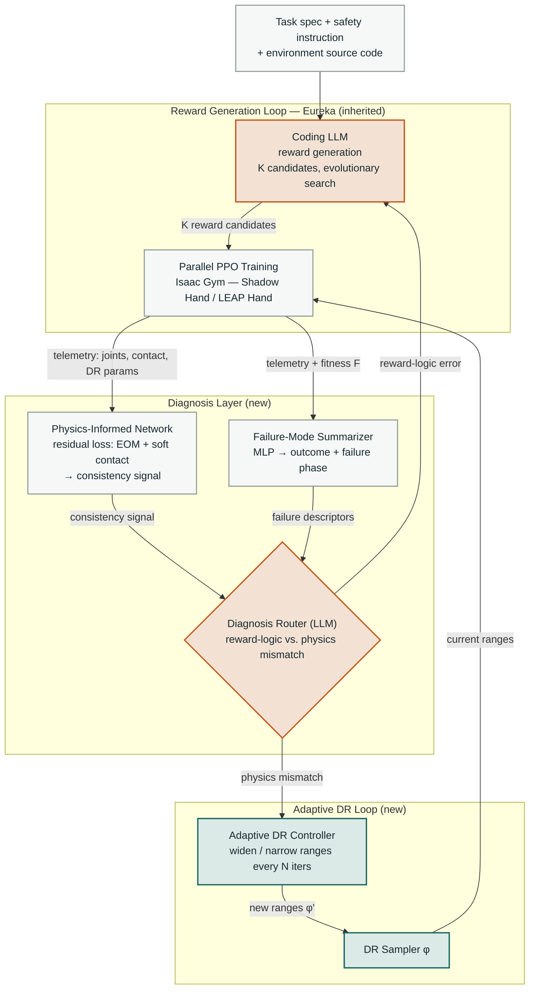
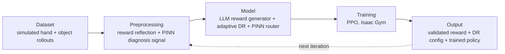

# System Architecture — Physics-Informed Adaptive Reward Generation

Two feedback loops share one diagnosis router: the inherited Eureka reward-edit loop, and the new adaptive-DR loop. The router is the safeguard that keeps the PINN's contribution measurable — each diagnosis can only trigger its own loop.

**Legend**
- Orange nodes — reward-edit path (unmodified from Eureka)
- Teal nodes — adaptive-DR path (new contribution)
- Grey nodes — shared infrastructure (training loop, diagnosis inputs)

---

## Simplified linear version (for the flow-diagram slide)

